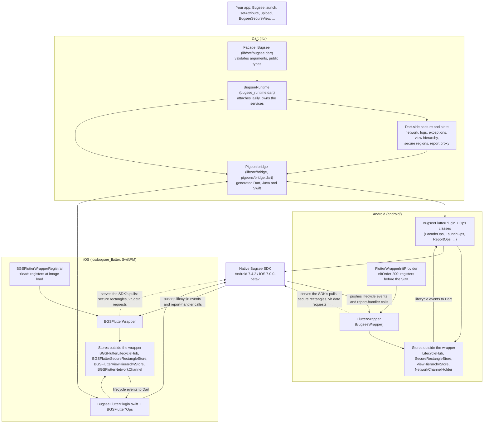

# Architecture

How `bugsee_flutter` is built, in the order a call travels, and the rules every layer keeps. The rules are the ones the
reviewers and the drift guards enforce; the long form of each is in `.claude/CLAUDE.md` and the page named next to it.

## Layers

* **Dart facade.** `Bugsee` is a set of statics over `BugseeRuntime`. It validates every argument first (so a bad call
  never reaches the SDK), keeps the capture services (network, logs, error handlers, the view-hierarchy publisher, the secure-region
  registry, the report-handler proxy) and attaches to the native side lazily, on the first call (`ensureStarted`). Nothing generated is
  exported from `lib/bugsee_flutter.dart`; `test/public_api_test.dart` pins the exported symbols and `Bugsee`'s members.
* **Pigeon bridge.** One typed host API (`pigeons/bridge.dart`) with Dart, Java and Swift outputs committed (never hand-edited;
  `dart scripts/generate_pigeon.dart --check` in CI). The bridge declares **no enum**: Pigeon would send ordinals, and enums cross by the
  SDK's internal value or by name (workbook 7.4). The feedback package has its own bridge.
* **Native plugin.** Per platform, a plugin class serves Dart, and small `*Ops` classes sit between it and the SDK behind a seam
  (an interface in Java, a protocol in Objective-C), so JUnit and XCTest see exactly what reaches the SDK. An SDK exception is caught
  natively and comes back as a failure code (an `NSException` escaping into Swift would crash the app).
* **Native wrapper.** The object the SDK talks to (`BugseeWrapper`): identity, lifecycle events, data requests (`vh`), secure
  rectangles, report handlers, and the wrapper channel (the SDK's injection route for network events and logs).

## Rules every layer keeps

### Register before launch

The SDK reads the wrapper while it builds a report's environment and dispatches report handlers, both during `launch()`, including the
recovery of a crash from the previous run. A wrapper registered from Dart is too late and fails **only on a relaunch after a crash**.

* Android: a `ContentProvider` at `initOrder="200"` (the SDK's own provider is 100; providers start in descending order),
  extending the SDK's `BugseeExtensionInitProviderBase`. Its class name must **not** match `^.*\.Bugsee[A-Za-z0-9_]+InitProvider$`: the
  Bugsee Gradle plugin silently deletes such a provider from the APK.
* iOS: `+load` of an Objective-C registrar, at image load, before `main`. (Registering from the Swift plugin would be too late for an
  app that launches Bugsee natively in `didFinishLaunching`: with an implicit engine, plugins register after it.)
* Natively only the type (`flutter`) and the version are known; Dart refines the identity (Flutter, Dart, engine, build mode) before the
  SDK launches. The type and version are repeated in Dart, Android and iOS and compared by `test/wrapper_identity_test.dart`.

### The wrapper is replaced; state lives outside it

When Dart refines the identity the wrapper object is replaced and the SDK retires the old one (and its wrapper channel). So nothing that
must survive lives in it: the lifecycle hub (buffers events until Dart attaches, replays the latest status, fans out to every engine),
the secure rectangles, the view-hierarchy snapshot and the wrapper channel are process-wide stores the wrapper only points at.
The same applies to created reports and report-handler state.

### Threads

* **No native wait for Dart on the platform thread.** iOS calls a report handler on the main thread and Dart's reply needs it, so a wait is
  a deadlock. The report-handler pipeline never waits (the SDK has its own timer), completes the SDK's callback exactly once, and a
  drift guard greps the report path for blocking primitives. `isTerminating` never reaches Dart.
* **The `vh` answer is synchronous.** The SDK asks for the view hierarchy on the main thread with a 500 ms budget (iOS does not ask the wrapper at all for a snapshot made on the main thread), so the wrapper answers
  from a native snapshot cache that Dart keeps current; it never waits for Dart.
* **Immutable snapshots.** The secure-rectangle buffer and the view-hierarchy snapshot are published as immutable values; the SDK pulls
  them from its own threads.
* **Native caches, per-call work off the UI thread.** Attachment file work runs on a one-thread worker, network and log batches on a serial
  background queue, an Android exception report on its own thread; none of it on the platform thread.
* **Lifecycle events** arrive on SDK worker threads and hop to the platform thread before touching Flutter.

### Fail closed (privacy)

* **Secure rectangles** (`BugseeSecureView`): Dart publishes logical pixels with the ratio it measured them at; native converts to the
  SDK's unit (Android physical pixels, iOS points) per pull. Anything unplaceable, non-finite, mis-scaled or stale covers the whole
  display; only a view known to be off screen serves nothing. A failed publish is retried forever.
* **View hierarchy**: only widget type names and boxes, built by an allow-list of reads; the SDK stores the string unread, so the privacy is
  ours. Any error sends nothing.
* **Network and log filters** run in Dart before anything reaches the SDK, and a throw, a wrong return type or a hang drops the event.
  Events are always submitted with `requiresFiltering = true` so the SDK's own sanitizer still runs.
* **Gates.** Nothing is recorded or queued before the SDK is launching or launched; the gate is mirrored in Dart and natively.
* **Option encoding** rejects what the SDKs would drop silently (an unknown key, a wrong type, a bad endpoint) before native is touched.

### One source for every pin, and guards that fail

`native-versions.json` is the single source of every native pin; each other copy (Gradle, `Package.swift`, example, CI, the feedback
package) is compared to it by tests. Values the SDKs define (enum values, timeouts, caps) are extracted from SDK source into
`test/fixtures/` and compared with the Dart, Java and Objective-C copies, never wrapper against wrapper. Every drift guard was seen
failing against a broken copy before it was trusted. [workbook-conformance.md](workbook-conformance.md) lists them per workbook step.

## Repository map

| Path | What |
|---|---|
| `lib/` | the Dart facade (`lib/src/bugsee.dart`, `bugsee_runtime.dart`) and services (`network`, `logs`, `exceptions`, `report`, `secure`, `view_hierarchy`, `options`, `bridge`) |
| `android/` | the plugin, the wrapper, the init provider, the `*Ops` seams, JUnit tests (`android/src/test`) |
| `ios/bugsee_flutter/` | the SwiftPM package: the Swift plugin and the Objective-C wrapper target (`bugsee_flutter_wrapper`) |
| `ios/wrapper_tests/` | a test-only package whose `Sources` is a symlink to the shipped Objective-C target (XCTest runs against the shipped code) |
| `pigeons/` | the Pigeon definition and the pinned generator package |
| `packages/bugsee_flutter_feedback/` | the separate feedback package (own bridge, own native code) |
| `scripts/` | generators, the pin and manifest checks, publish helpers, and the device harness (`scripts/device/`) |
| `test/` | Dart tests and the drift guards; `test/fixtures/` holds SDK facts extracted from source |
| `example/` | the example app, the integration tests and the verification app |
